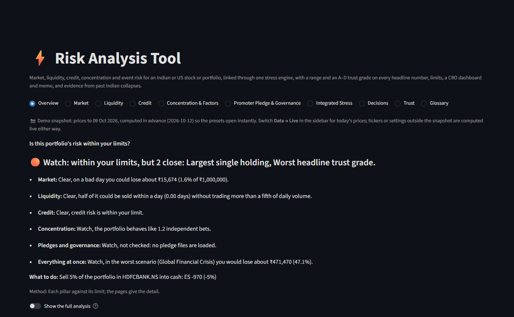
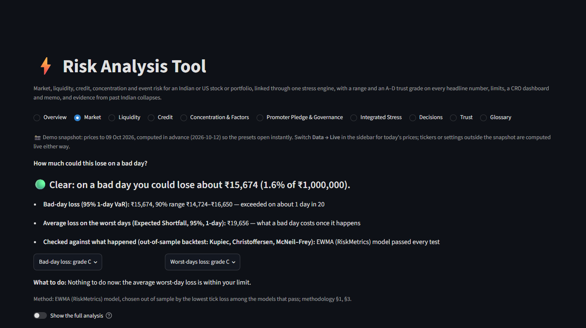
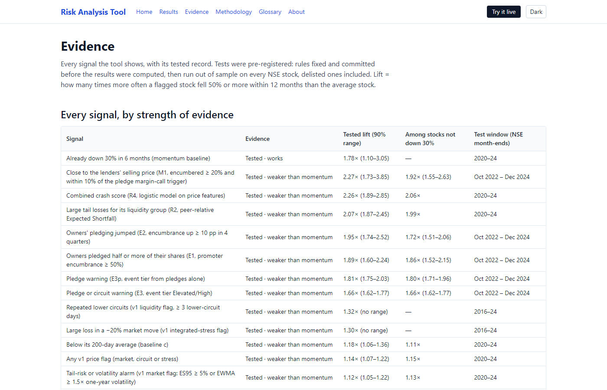

# Risk Analysis Tool

[](https://github.com/singhwilliam15/Risk-Analysis-Tool/actions/workflows/tests.yml)

[](LICENSE)

**Which warning signs actually predict a 50% crash in an Indian stock, and how much could a portfolio lose when
market, liquidity, credit and promoter-pledge risk hit together?** This tool measures all five pillars for an Indian
or US stock or portfolio, links them in one stress engine, gives every headline number a 90% range and an A–D trust
grade, and shows each warning signal's tested record on every NSE stock, failures included.

**[Website](https://singhwilliam15.github.io/Risk-Analysis-Tool/)** (results for 8 presets) ·
**[Live app](https://risk-analysis-tool.streamlit.app/)** (any NSE, BSE or US ticker) ·
**[Research note](docs/research_note.md)** ([PDF](docs/research_note.pdf)) · [The 2-minute story](docs/interview_story.md)

| Every page opens with a verdict | Plain words, technical terms in brackets | Every signal's tested record |
| --- | --- | --- |
| [](docs/images/summary-overview.png) | [](docs/images/summary-market.png) | [](docs/images/website-evidence.png) |

## Six findings, with their evidence

Tests were pre-registered (rules committed before results) and run on every NSE stock, delisted ones included.
Lift = how many times more often flagged stocks fell 50% within a year than the average stock.

1. **Momentum is the rule to beat.** "Down 30% in six months" flagged stocks that crashed 1.78 times as often as
   average out of sample, 2020–24 (90% range 1.10–3.05). [Research note](docs/research_note.md)
2. **The tool's original price flags barely beat chance.** On 2,315 stocks, 2016–24, their lift is 1.13, while
   "down 30% in six months" does twice as well (2.24): one tail-risk threshold fires on 73% of all NSE stock-dates.
   [Wider test](docs/case_studies.md#wider-test-every-nse-stock-20162024-review-m1)
3. **Better rules, not confirmably better than momentum.** The pre-registered challenger reached a lift of 2.26
   against momentum's 1.78, but the 90% interval of the difference (−0.58 to +1.05) includes zero, so the app keeps
   the old flag and says why. [Warnings v2](docs/case_studies.md#warnings-v2-out-of-sample-test-october-2026)
4. **Promoter pledges warn, and catch what momentum misses.** On 27,033 NSE shareholding filings, stocks with half
   or more of promoter shares pledged fell 50% 1.9 times as often as average (90% range 1.6–2.2). They don't beat
   momentum, which had a lift of 2.4, but among stocks not already down 30% the lift stays at 1.9.
   [Wider event test](docs/case_studies.md#wider-event-test-every-nse-stock-20212024-october-2026)
5. **Being close to the lenders' selling price adds little beyond the pledge level:** crash-rate ratio 1.29 (90%
   range 0.93–2.25), so the pre-registered hypothesis is not supported. [Margin-trigger test](docs/case_studies.md#margin-trigger-distance-every-nse-stock-20222024-october-2026)
6. **Before six Indian collapses it warned on 19 of 24 dates**, with false alarms on 9.2% of 240 control dates.
   "Price below its 200-day average" also warned on 18, with 25% false alarms, so the edge is precision. An assumed
   crash overlay failed its own test and now defaults to zero. [Case studies](docs/case_studies.md)

## What it does

| Pillar | Highlights |
| --- | --- |
| **Market** | 8 VaR/ES models, from historical to GARCH(1,1)-t and Monte Carlo. Out-of-sample Kupiec, Christoffersen and McNeil-Frey ES tests; the recommended model must pass the ES test too. Euler risk split; measured crisis replays. |
| **Trust** | A 90% range for every model (block bootstrap, GARCH parameter draws) and an A–D grade from written rules, with reasons. Model risk, lookback sensitivity, ghost effect. |
| **Liquidity** | Days to liquidate, AMFI-style stress test, Corwin-Schultz spread, square-root impact, liquidity-adjusted VaR, official NSE price bands and circuit-lock freezes. |
| **Credit** | Merton distance to default with its percentile, agency default rates (CRISIL, ICRA studies), Altman Z/Z''. Banks and NBFCs against RBI PCA thresholds; bonds and loans with expected loss and spread stress. |
| **Concentration** | Fama-French-Carhart factors (IIMA India, Kenneth French US) with Newey-West errors, factor/specific risk split, effective number of bets, crisis correlation. |
| **Promoter pledge & governance** | Pledge level and 4-quarter change (promoter encumbrance), the margin-call trigger price and the forced selling in days of volume, with their tested record. Other red flags (ASM/GSM, rating actions, auditor events, F&O ban, group links) each carry an evidence badge. The jump overlay is off by default and kept in the analyst details. |
| **Integration & decisions** | Linked stress as a price fixed point with a Shapley split and interaction, jump to default, reverse stress (stock and macro space), risk-change attribution, risk-reducing trades, limits, CRO dashboard and one-page memo. |
| **Plain-language view** | Every page opens with the question it answers, a status (**Clear / Watch / Warning**, always written out), a one-line verdict, the key facts, what to do and the method behind each number. Terms are in plain words with the technical name in brackets ("Bad-day loss (95% 1-day VaR)"); a Glossary page defines them. The sidebar switches between **Summary** and **Full analysis**; the memo opens with an "In plain words" paragraph. |

More: [features and live results](docs/features.md) · [methodology and references](docs/methodology.md) ·
[case studies and the wider test](docs/case_studies.md) · [deploying](docs/deploy.md) ·
[the 2-minute story](docs/interview_story.md) · [research note](docs/research_note.md) · [plans](docs/plans/README.md)

## Run it

Requires Python 3.11 or 3.12.

```bash
git clone https://github.com/singhwilliam15/Risk-Analysis-Tool.git
cd Risk-Analysis-Tool
pip install -r requirements.txt
streamlit run app.py
```

Tickers use Yahoo Finance symbols: `RELIANCE.NS` (NSE), `.BO` (BSE), `AAPL` (US). On Windows you can double-click
`run_app.bat`.

| Run | First page | All 10 pages | Peak memory |
| --- | --- | --- | --- |
| Demo snapshot (default portfolio) | 4.3 s | 11.9 s | 367 MB |
| Live downloads and calculations | 51.2 s | 58.3 s | 365 MB |

Measured cold on a laptop with `scripts/measure_app.py` on 12 Oct 2026. Streamlit Community Cloud allows at least 690 MB, and
`test_deploy.py` checks the snapshot run stays under it.

## Tests

```bash
pip install -r requirements-dev.txt
pytest
```

There are 677 tests, run offline in CI on Python 3.11 and 3.12. The network is blocked, so market data come from a
synthetic generator, saved real files or the bundled snapshot. Each calculation is checked against an independent
reference: a closed form, a large simulation, a hand calculation or a known true parameter.
[What they check](docs/features.md#tests).

**Data refresh scripts** (in `scripts/`). The NSE downloaders are no longer run: NSE's terms forbid automated
collection without its written permission ([data sources](docs/data_sources.md)).


| Script | Refreshes |
| --- | --- |
| `fetch_disclosures.py` | NSE pledges, bands, surveillance and ratings (not run since Oct 2026) |
| `fetch_bank_results.py` | Bank results XBRL |
| `refresh_factor_data.py` | Factor files |
| `fetch_bhavcopy.py` + `run_universe.py` | The wider test (not run since Oct 2026) |
| `build_snapshot.py` | The demo snapshot |
| `site_data/build.py` (repository root) | The website's data (then `npm run build` in `web/`) |
| `build_research_note.py` | The research note from the results files |

## Limits, in short

- Long-only, single-currency portfolios.
- Merton PDs are risk-neutral.
- No NSE lists ship with the repo: pledges, price bands, surveillance, F&O bans and ratings come from files you
  upload, and the pledge page says "not checked" without them.
- The event tiers' jump risk is calibrated on disclosure data for 2021–2024 only (NSE's pledge history starts in
  September 2021), and pledges are measured together with other encumbrances before mid-2025.
- The wider test covers price-based flags only.

The full list is in [features.md](docs/features.md#limitations).

## License

[MIT](LICENSE)
