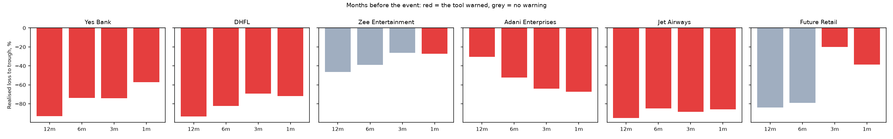

# Did it see it coming? Case studies on Indian collapses

The tool was run **as of 12, 6, 3 and 1 month(s) before** each collapse. Each run used only data public on that date: prices up to the date, statements public by then, and disclosures by their public dates. The results are compared with what happened next, and with a control group of 10 large, stable NSE stocks at the same dates. Run it with `python case_studies/run.py`; results go to `case_studies/results/`.

**Coverage (11 Oct 2026).** Market, liquidity, integrated stress and **credit** are assessed for every case; **events** where NSE's history reaches.
- **Credit** runs on consolidated statements transcribed from each company's annual report on NSE: Zee FY2017–18, Jet Airways FY2017–18, Future Retail FY2019 and Adani Enterprises FY2021–22, in `case_studies/data/fundamentals/`. Each figure gives its report URL and PDF page. Every year ties exactly (total assets = equity + liabilities), and the filing date is the annual report's NSE filing date (point in time). Yes Bank and DHFL are financials, which Merton does not model.
- **DHFL** has prices since October 2026, from NSE's own daily bhavcopies, adjusted as in the wider test (`scripts/build_case_prices.py`), because Yahoo has dropped it.
- **Events** use NSE's shareholding history, Sep 2021 – Dec 2024 (see the wider event test below). That covers Adani Enterprises and the controls on Adani's dates.
  - The 2017–2020 cases stay **not available**, never "no risk". NSE serves no shareholding XBRL before September 2021, BSE refuses scripted downloads, and collecting the pages by hand was not done.
  - The figures are "pledged or otherwise encumbered", the only measure filed before mid-2025.

## Cases

| Case | Event date | Event | Prices |
| --- | --- | --- | --- |
| Yes Bank | 5 Mar 2020 | RBI places Yes Bank under a moratorium and supersedes its board | Yahoo |
| DHFL | 4 Jun 2019 | DHFL misses interest payments on its bonds | NSE bhavcopies, adjusted (delisted; Yahoo returns 404) |
| Zee Entertainment | 25 Jan 2019 | Share price collapses on promoter-pledge and lender concerns | Yahoo |
| Adani Enterprises | 24 Jan 2023 | Hindenburg Research publishes its short-seller report | Yahoo |
| Jet Airways | 17 Apr 2019 | Jet Airways suspends all flights | Yahoo |
| Future Retail | 29 Aug 2020 | Future Group agrees to sell its retail business to Reliance after defaults | Yahoo |

**Control group:** Reliance, TCS, HDFC Bank, Infosys, Hindustan Unilever, ITC, Kotak Mahindra Bank, Asian Paints, Nestlé India and Britannia, each at every case's four dates.

## What counts as a warning (assumptions)

At each as-of date, using the last 500 trading days up to it:

| Pillar | Flag |
| --- | --- |
| Market | EWMA volatility ≥ **1.5×** the past year's volatility, **or** 1-day 95% historical ES ≥ **5%** |
| Liquidity | ≥ 3 lower-circuit days in the window (the Elevated event rule, §12.2 of the methodology) |
| Credit | Merton DD < 3, or Altman Z'' in the distress zone (needs statements). Banks: any RBI PCA risk threshold breached, or an early warning (2021 thresholds applied as a benchmark) |
| Events | event tier Elevated or High (needs disclosure files) |
| Integrated stress | a −20% market move, run through the linked engine (downside beta, volatility doubled, liquidity, circuit freeze), loses ≥ **30%** of a ₹1 crore position |

**Warning** = any flag. **Realised loss** = the fall from the as-of close to the lowest close between the as-of date and 63 trading days after the event.

## Results

| Case | As of | Market ES (headline model, grade) | Flags | Warning | Realised loss |
| --- | --- | --- | --- | --- | --- |
| Yes Bank | 12m (5 Mar 2019) | 11.1% (EWMA, C) | market | **yes** | −93% |
| Yes Bank | 6m (5 Sep 2019) | 18.2% (FHS, B) | market, stress | **yes** | −74% |
| Yes Bank | 3m (5 Dec 2019) | 19.3% (Cornish-Fisher, C) | market, stress | **yes** | −74% |
| Yes Bank | 1m (5 Feb 2020) | 18.8% (Cornish-Fisher, C) | market, stress | **yes** | −57% |
| Zee Entertainment | 12m (25 Jan 2018) | 3.7% (Cornish-Fisher, B) | none | no | −46% |
| Zee Entertainment | 6m (25 Jul 2018) | 3.5% (Cornish-Fisher, A) | none | no | −39% |
| Zee Entertainment | 3m (25 Oct 2018) | 3.5% (Student-t, B) | none | no | −26% |
| Zee Entertainment | 1m (25 Dec 2018) | 3.2% (Normal, B) | market (volatility 1.63×) | **yes** | −27% |
| Adani Enterprises | 12m (24 Jan 2022) | 9.3% (GARCH-t, C) | market | **yes** | −30% |
| Adani Enterprises | 6m (24 Jul 2022) | 6.4% (Cornish-Fisher, B) | market | **yes** | −52% |
| Adani Enterprises | 3m (24 Oct 2022) | 6.4% (Student-t, B) | market | **yes** | −64% |
| Adani Enterprises | 1m (24 Dec 2022) | 6.6% (Student-t, B) | market | **yes** | −67% |
| Jet Airways | 12m (17 Apr 2018) | 5.9% (Student-t, A) | market, stress | **yes** | −95% |
| Jet Airways | 6m (17 Oct 2018) | 7.4% (Cornish-Fisher, C) | market | **yes** | −85% |
| Jet Airways | 3m (17 Jan 2019) | 7.0% (Normal, C) | market | **yes** | −88% |
| Jet Airways | 1m (17 Mar 2019) | 7.1% (Normal, C) | market | **yes** | −86% |
| Future Retail | 12m (29 Aug 2019) | 5.0% (Cornish-Fisher, B) | none | no | −84% |
| Future Retail | 6m (29 Feb 2020) | 4.6% (EWMA, B) | none | no | −79% |
| Future Retail | 3m (29 May 2020) | 12.3% (FHS, B) | market, **liquidity** (26 lower-circuit days, longest run 18), stress | **yes** | −20% |
| Future Retail | 1m (29 Jul 2020) | 12.1% (FHS, B) | market, **liquidity** (37 lower-circuit days), stress | **yes** | −39% |
| DHFL | 12m (4 Jun 2018) | 3.9% (GARCH-t, B) | market (ES95 5.2%), stress | **yes** | −93% |
| DHFL | 6m (4 Dec 2018) | 8.7% (GARCH-t, C) | market, stress | **yes** | −82% |
| DHFL | 3m (4 Mar 2019) | 9.6% (GARCH-t, C) | market, stress | **yes** | −69% |
| DHFL | 1m (4 May 2019) | 10.3% (GARCH-t, A) | market, stress | **yes** | −72% |

ES is 1-day at 95% for the recommended model, with the Trust grade. Since the October 2026 review fix the recommended model must also pass the ES test. At three dates (Yes Bank 6m, Future Retail 3m and 1m) EWMA had been recommended while failing it, at grade D; FHS replaces it with a 27–50% higher ES. The warnings do not use the grade, so the tally is unchanged. The 90% ranges are in `case_studies/results/results.csv`.

### Hits, misses and false positives

| Pillar | Case dates | Hits | Misses | Control dates | False positives |
| --- | --- | --- | --- | --- | --- |
| Market | 24 | 19 | 5 | 240 | 16 (6.7%) |
| Liquidity (circuits) | 24 | 2 | 22 | 240 | 0 |
| Credit | 20 | 12 (60%) | 8 | 20 | 0 (HDFC Bank, PCA; no statements for the other controls; DHFL, an NBFC, not modelled) |
| Events | 4 (Adani) | 0 | 4 | 34 | 0 (pledge history from Sep 2021 only) |
| Integrated stress | 24 | 10 | 14 | 240 | 6 (2.5%) |
| **Any warning** | **24** | **19 (79%)** | **5** | **240** | **22 (9.2%)** |

### What this shows, honestly

- **Yes Bank's bank panel saw it 6 months out, on public data** (October 2026, bank module). Its FY2019 annual report (filed 16 May 2019) showed CET1 at 8.4%: below today's PCA trigger of 8.625% (risk threshold 1). By December 2019 its September-quarter results showed gross NPA up 6.08 pp in a year (1.31% → 7.39%). It was not flagged 12 months out, when CET1 was 9.7%. **Caveat:** these are the 2021 PCA thresholds, applied as a benchmark; the 2017 framework in force in 2019 used different CET1 levels, which were not verified here. HDFC Bank, a control, was never flagged (17 dates, at least 5.5 pp clear of every trigger).
- **Yes Bank and Jet Airways were visible in prices a year ahead.** Both had already fallen hard, so their ES was 6–19% a day and every date warned. A price-based tool flags a stock that is already falling; that is not a forecast of the moratorium or the grounding.
- **Zee was missed for a year, and Future Retail for six months.** Their volatility looked ordinary until shortly before the end, while a holder at the 12-month date went on to lose 46% (Zee) and 84% (Future Retail).
  - Zee's risk was in promoter pledges, and Future Retail's in group debt and pledges.
  - **Credit did not catch them** (October 2026, statements loaded): Zee's DD was 15–18 with Z'' safe at every date, and Future Retail's DD was 7–9 at 12 and 6 months. Credit warned on 9 of 16 dates (Jet Airways at every date on negative equity, Adani from 6 months on Z'' only, Future Retail at 3 and 1 months after the COVID crash), but **added no warning the price pillars had not already given**.
  - Events are the pillar for Zee, but NSE serves pledge history only back to September 2021, so they still cannot be scored here (the wider event test below scores them on 2021–2024 instead).
- **Future Retail is where the liquidity pillar earned its place.** By May 2020 the stock had hit its 5% lower circuit on 26 days, including a run of 18 in a row. The circuit flag fired at 3 and 1 months, and the integrated stress showed a 70% loss on a −20% market move. A VaR model alone sees a volatile stock; the circuit history shows a holder who could not sell.
- **Adani Enterprises "warned" because it was always volatile, not because of an early signal.** Its ES was above 5% at every date, and the 12-month window includes the March 2020 crash. **The events pillar, now with NSE data, stayed Low on all 4 dates:** encumbrance was 2–4% of promoter holding. The Hindenburg report was not about pledges.
- **DHFL warned at every date from 12 months out** (market and integrated stress). By June 2018 its ES95 was already 5.2%, and a −20% market move cost 44% through the linked engine. The 21 Sep 2018 crash (−42% in a day) came three months later. As with Yes Bank, the price was already showing stress; the bond default a year later was not forecast as such.
- **False positives were 9.2% overall (22 of 240).** DHFL's dates added three: HDFC Bank in June 2018 (a volatility jump), and Reliance in March and May 2019 (integrated stress, from its high downside beta). Most of the others share one artefact: after March 2020, every 2-year window contains the COVID crash, so large caps' ES passes the 5% threshold. Examples are Reliance, Infosys and Kotak at the Future Retail dates, and Reliance and Kotak in January 2022. The others were volatility jumps in large caps not followed by large losses, plus 4 integrated-stress flags on Reliance, whose high downside beta makes a −20% market move cost about 30%.
  - A rule that adapts to the market's own ES would cut these. I have not changed the rule after seeing the results, to avoid fitting the test.
- **Small sample.** Twenty-four case dates from six stocks illustrate what the tool can and cannot see; they are not statistically meaningful.

### Does it beat a naive rule? (review M1)

Three rules anyone could apply, fixed before the run exactly as the review states them, on the same 264 dates and using only prices up to each date (`case_studies/engine.py::baselines`):
- (a) the stock is down **30% or more over the previous 6 months** (126 trading days);
- (b) its **60-day volatility is in the top decile** of its own rolling 60-day volatility over the previous 5 years (at least 500 values needed, otherwise "not available");
- (c) it closes **below its 200-day average**.

| Rule | Hits (of 24) | False positives (of 240) | Cases warned at some date (of 6) | Mean earliest warning |
| --- | --- | --- | --- | --- |
| **Tool: any warning** | **19 (79%)** | **22 (9.2%)** | **6** | **8.7 months before** |
| (a) Down ≥ 30% in 6 months | 9 (38%) | 0 (0%) | 4 | 6.75 |
| (b) Volatility in own top decile | 10 (42%) | 29 (12.1%) | 5 | 5.0 |
| (c) Below 200-day average | 18 (75%) | 60 (25.0%) | 5 | 9.6 |
| Any baseline | 18 (75%) | 78 (32.5%) | 5 | 9.6 |

Earliest warning per case, in months before the event (– = never warned):

| Rule | Yes Bank | DHFL | Zee | Adani Ent. | Jet Airways | Future Retail |
| --- | --- | --- | --- | --- | --- | --- |
| Tool: any warning | 12 | 12 | 1 | 12 | 12 | 3 |
| (a) Down ≥ 30% | 12 | 6 | – | – | 6 | 3 |
| (b) Volatility top decile | 12 | 6 | 1 | – | 3 | 3 |
| (c) Below 200-day average | 12 | 6 | 6 | – | 12 | 12 |

What this says, plainly:
- **The tool catches about as much as the simplest trend rule.** It hits 19 of 24 case dates; "below its 200-day average" hits 18.
- **It gets there with far fewer false alarms:** 9.2% of control dates against 25.0% for the 200-day rule and 32.5% for any baseline. On these dates the tool's value is precision, not extra recall.
- **The 200-day rule warned earlier on two cases the tool was late on:** Zee at 6 months (the tool only at 1 month) and Future Retail at 12 months (the tool at 3). A falling price was the earliest public sign there, and the tool's volatility-based market rule did not react to a slow decline.
- **DHFL is the one case where the tool warned earlier than every baseline:** 12 months out, against 6 for all three. Its ES was already above 5% while the price had not yet fallen 30% or crossed its 200-day average.
- **The only case no baseline saw is Adani Enterprises**, and that "warning" is its permanently high volatility (ES above 5%), not an early signal (see above).
- **"Down 30% in 6 months" never fired on a control** but caught only 9 of 24 case dates: precise and late.
- **24 case dates from 6 stocks cannot separate these rules statistically.** The wider test below uses the whole NSE universe for that.

Full rows: `case_studies/results/tally.csv` (pillars and baselines), `lead_times.csv` (earliest warning per case), `results.csv` (every date).

## Wider test: every NSE stock, 2016–2024 (review M1)

The 220 case and control dates select on the outcome. This test does not. It covers **every company listed on NSE** in the daily bhavcopies, including the 397 that later stopped trading, which Yahoo has dropped. It runs on the last trading day of each month from January 2016 to December 2024, and asks whether a stock **fell 50% or more from that close within the next 12 months**.

**Data** (`scripts/fetch_bhavcopy.py`, `universe.py`):
- NSE's daily bhavcopies, 22 Jun 2011 – 30 Jan 2026: 3,604 trading days and 3,050 companies (extended in October 2026 from 2014–2025, for the warnings-v2 test; earlier files have no ISIN). Only company shares are kept (ISIN INE…, series EQ, BE and BZ), not ETFs or bonds.
- Prices are back-adjusted for 997 bonuses and splits from NSE's corporate-action list. NSE's previous close is not adjusted: Reliance's 1:1 bonuses would otherwise show as −50% days.
- Renamed symbols are chained using NSE's symbol-change file.
- 1,465 daily moves beyond ±40% have no listed bonus or split, in 192 symbols. They come from demergers, splits missing from NSE's list (JSW Steel 2017), and thin trading with weeks between trades. A separate run without these symbols gives the same conclusions.
- The benchmark is the Nifty 50 index from Yahoo; an index has no survivorship problem.

**Design, fixed before the run:**
- Universe: every stock with at least 250 prior trading days that traded in the 5 days before the date: 2,315 stocks and 174,532 stock-dates.
- Liquid subset: median 60-day traded value of at least ₹1 crore, 87,174 stock-dates.
- The tool's rules are applied exactly as in the case studies, through the same function (`engine.price_flags`):
  - market: EWMA ≥ 1.5× one-year volatility, or ES95 ≥ 5%;
  - liquidity: 3 or more lower-circuit days;
  - integrated stress: a −20% market move costing 30% or more.
- The baselines are the same three rules as above.
- Credit and events cannot be tested here: there are no point-in-time statements or disclosures for 2,315 companies.

**Results** (stock-dates; precision = share of flagged dates followed by a ≥ 50% fall; recall = share of falls that were flagged; lift = precision ÷ the base rate):

| Rule | All stocks: flagged | Precision | Recall | **Lift** | Liquid stocks: flagged | Precision | Recall | **Lift** |
| --- | --- | --- | --- | --- | --- | --- | --- | --- |
| *Base rate (a ≥ 50% fall followed)* | | *15.1%* | | | | *10.6%* | | |
| Tool: any price flag | 78.8% | 17.1% | 89.3% | **1.13** | 65.9% | 13.2% | 82.1% | **1.25** |
| Tool: market | 72.8% | 17.1% | 82.6% | 1.14 | 62.0% | 13.0% | 76.0% | 1.23 |
| Tool: liquidity (circuits) | 37.2% | 19.9% | 49.1% | 1.32 | 17.3% | 17.6% | 28.8% | 1.67 |
| Tool: integrated stress | 60.1% | 19.6% | 78.2% | 1.30 | 37.6% | 17.3% | 61.5% | 1.63 |
| (a) Down ≥ 30% in 6 months | 11.6% | **33.9%** | 26.1% | **2.24** | 6.1% | **26.4%** | 15.2% | **2.49** |
| (b) Volatility in own top decile | 9.7% | 18.0% | 11.6% | 1.20 | 9.7% | 13.7% | 12.5% | 1.29 |
| (c) Below 200-day average | 46.5% | 21.7% | 66.8% | 1.44 | 36.6% | 15.1% | 52.1% | 1.43 |
| Any baseline | 51.6% | 20.7% | 70.7% | 1.37 | 42.6% | 14.3% | 57.6% | 1.35 |

What this says, plainly:
- **On the whole market, the tool's price flags barely beat chance and lose to a naive rule.** "Any price flag" fires on 79% of stock-dates with a lift of 1.13. "Down 30% in 6 months" fires on 12% with a lift of 2.24, and "below the 200-day average" does better than the tool on every measure but recall.
- **The reason is one threshold.** Daily ES95 ≥ 5% was set with large caps in mind. It is true on 71.6% of all NSE stock-dates, because small caps routinely have one-day tail losses that large. The 220-date test hid this: its controls are ten large caps.
  - I have not changed the threshold after seeing this, to avoid fitting the test. Rules relative to the stock's own history and to its liquidity bucket were then tested out of sample: see [Warnings v2](#warnings-v2-out-of-sample-test-october-2026).
- **The tool's better flags are the circuit and stress ones**, with lifts of 1.3 overall and about 1.65 on liquid stocks. The stress flag's lift was above 1.1 in every year from 2016 to 2024.
- **The momentum baseline is the strongest single rule, but not a stable one.** Its lift ranges from 0.76 (2020, when the COVID crash flagged everything and the market recovered) to 4.11 (2023).
- **The conclusions hold under the stated alternatives:**
  - counting every stock that disappeared as a ≥ 50% loss (an upper bound, since mergers and buyouts also disappear): the tool's lift is 1.14, momentum's 2.25;
  - dropping the 192 symbols with unexplained moves: 1.14 and 2.32.
- **Survivorship:** delisted companies are included for as long as they traded on NSE. Companies listed only on BSE, and trading after an NSE delisting, are not.

Files: `case_studies/results/universe_metrics.csv` (all variants), `universe_yearly.csv`, `universe_meta.json` (counts); the stock-level rows are rebuilt by `scripts/run_universe.py` (14 minutes on 7 cores).

## Warnings v2: out-of-sample test (October 2026)

The wider test above showed the v1 flags barely beat chance. Phase F tested four replacement rules, using a
design that fixed every choice before the results were seen:
- **Pre-registration:** [docs/preregistration_warnings_v2.md](preregistration_warnings_v2.md), committed before any
  result was computed. Its one amendment, the panel's start date, was also made before any result.
- **Design period:** month-ends 2016–2018.
- **Embargo:** 2019, whose outcomes overlap the test.
- **Test period:** month-ends 2020–2024, evaluated **once**, with the R4 model and the choice of challenger frozen
  in a commit beforehand.
- **Outcome:** as above, a fall of ≥ 50% within 12 months.
- **Universe:** every NSE stock, with the panel extended to June 2011 – January 2026 so that every rule has its
  full history.

**The candidates:**
- **R1:** ES95 in the stock's own top decile of the last 3 years.
- **R2:** ES95 in the top decile of its liquidity tercile on that date.
- **R3:** EWMA volatility ≥ 1.5 × one-year volatility, and the close below its 200-day average.
- **R4:** a logistic score on seven price features, fitted on 2016–2018 only.

**The challenger.** R4 was picked on the design period, as the best lift among rules flagging 5–25% of
stock-dates. Its design lift of 2.45 is in-sample. R3 flagged only 1.7% and was not eligible.

**Decision rule.** R4 replaces the v1 market flag only if all of these hold on the test period:
- its lift beats v1;
- its lift beats "down ≥ 30% in 6 months";
- the lower end of the 90% interval for its lift minus momentum's lift is above zero.

**Test period, all NSE stocks** (102,207 stock-dates, base rate 6.3%). The 90% ranges come from a paired block
bootstrap over runs of 12 consecutive month-ends, 2,000 resamples. The lead time is from the as-of date to the
lowest close, on correct warnings.

| Rule | Flagged | Precision | Recall | **Lift (90% range)** | Lead time (trading days) |
| --- | --- | --- | --- | --- | --- |
| **R4 combined score (challenger)** | 4.1% | 14.3% | 9.2% | **2.26 (1.89–2.85)** | 143 |
| R2 peer-relative ES | 10.1% | 13.1% | 20.8% | **2.07 (1.87–2.45)** | 157 |
| R1 own-history ES | 16.7% | 5.9% | 15.5% | 0.93 (0.73–1.53) | 132 |
| R3 volatility shock with trend | 1.9% | 5.4% | 1.6% | 0.85 (0.48–2.32) | 151 |
| v1 any price flag | 80.9% | 7.2% | 92.4% | 1.14 (1.07–1.22) | 162 |
| v1 market flag | 75.8% | 7.1% | 85.2% | 1.12 (1.05–1.22) | 162 |
| (a) Down ≥ 30% in 6 months | 7.7% | 11.3% | 13.7% | **1.78 (1.10–3.05)** | 153 |
| (b) Volatility in own top decile | 10.1% | 6.2% | 9.9% | 0.98 (0.68–1.61) | 155 |
| (c) Below 200-day average | 38.4% | 7.5% | 45.5% | 1.19 (1.06–1.36) | 150 |

**Lift by year on the test period:**

| Year | R4 | R2 | (a) momentum | v1 any flag |
| --- | --- | --- | --- | --- |
| 2020 | 1.93 | 1.99 | 0.76 | 0.95 |
| 2021 | 1.27 | 2.03 | 2.61 | 1.08 |
| 2022 | 2.72 | 2.15 | 2.82 | 1.20 |
| 2023 | 2.49 | 3.18 | 4.11 | 1.29 |
| 2024 | 2.13 | 1.91 | 2.49 | 1.28 |

**Beyond momentum.** Among the 94,296 stock-dates *not* already down 30% (base rate 5.9%):
- R4's lift is 2.06, flagging 2.9%.
- R2's lift is 1.99, flagging 9.1% and catching 18.2% of the crashes.
- v1's lift is 1.15.

**Liquid stocks only** (median traded value ≥ ₹1 crore, base rate 5.3%):
- R2: 2.23 (2.03–2.53);
- R4: 2.33 (1.75–3.25), flagging only 1.9%;
- momentum: 1.81 (1.20–2.98);
- v1: 1.26.

**Verdict, plainly:**
- **The pre-registered challenger did not win, so the app keeps v1.** R4's lift (2.26) is higher than momentum's
  (1.78), but the 90% interval of the difference runs from −0.58 to +1.05. The test cannot rule out that
  momentum is as good. The Market page shows v1 in use and R4 beside it, with both records.
- **The intervals are wide mainly because momentum is unstable.** Its lift was 0.76 in 2020, when the COVID crash
  put 19% of stocks 30% down and most recovered, and 4.11 in 2023. Five test years are few independent
  observations.
- **Exploratory, not pre-registered as the challenger:**
  - R2, a simple rule ("tail risk high for a stock of this liquidity"), held a lift of 1.9–3.2 in every test
    year, including 2020, with the tightest interval of any rule.
  - It kept a lift of about 2 on stocks that had *not* already fallen 30%, so it adds information beyond
    momentum.
  - It deserves its own fresh test on data after 2024, not adoption on this result.
- **Two candidates failed outright.** R1, tail risk high relative to the stock's own past, and R3, a volatility
  shock in a downtrend, did no better than chance. A stock's own volatility spikes tend to revert.
- **R4 flagged fewer stock-dates on the test (4.1%) than on the design period (9.0%).** Its threshold is a
  probability fitted when crashes were common (21% base rate, 2016–2018). In the calmer test years (6.3%) fewer
  scores pass it. This was fixed in advance and is reported, not adjusted.
- **Disappearances counted as crashes** (an upper bound): R4 2.49, momentum 1.92, R2 1.94, v1 1.14.

Files: `case_studies/results/warnings_v2_design.csv`, `warnings_v2_model.json` (frozen before the test),
`warnings_v2_test.csv`, `warnings_v2_bootstrap.csv`, `warnings_v2_incremental.csv`, `warnings_v2_yearly.csv`,
`warnings_v2_decision.json`, and `warnings_v2_reference.json` (the NSE cross-section of 30 Jan 2026 that the app
uses for R2 and R4). The rows are rebuilt by `scripts/run_universe.py --stage design` and then `--stage test`
(14 minutes on 7 cores).

## Wider event test: every NSE stock, 2021–2024 (October 2026)

The event pillar had never been tested: the case-study disclosures were missing, and NSE's pledge history starts in
2021. This test uses what NSE *does* serve. That is every company's quarterly shareholding-pattern XBRL from
**Sep 2021 to Dec 2024**: 27,033 filings from 2,165 companies, each the quarter's original filing, public from its
broadcast date (`scripts/fetch_shareholding_history.py`). The rules, windows, metrics and readings were fixed in
[docs/preregistration_events.md](preregistration_events.md) before any result was computed.

**What the data can and cannot measure:**
- **It measures encumbrance, not pledges.** Until mid-2025 the filings report shares "pledged *or otherwise
  encumbered*", which includes non-disposal undertakings, so it is an upper bound on pledges. Jaiprakash Power was
  94.6% encumbered in Sep 2022 and 72.99% pledged in 2025; TCS is 0.48% encumbered with no pledges.
- **Pledges and circuits are the only signals with history.** NSE's rating feed returns nothing for these years,
  and the surveillance lists are current only. So the tier here uses only the pledge signal and lower-circuit days.
- **Sep 2021 filings count from January 2022.** NSE broadcast their XBRL about 84 days after submission, and the
  broadcast date is used.
- **Coverage:** 98.7% of stock-dates have a filing; 140 filings could not be downloaded (HTTP 404), and 21
  companies' filings match no traded stock.
- **One data bug was fixed before any result was computed:** NSE's list leaves the ISIN blank for 77 companies,
  Reliance among them (pre-registration amendment 1).

**The rules:**
- **E1:** encumbered ≥ 50% of promoter holding.
- **E2:** encumbrance up ≥ 10 pp in four quarters.
- **E3:** event tier Elevated or High, from pledges and circuits.
- **E3p:** the same tier from pledges alone.

**Primary window,** month-ends Oct 2022 – Dec 2024: 49,244 stock-dates, base rate 6.2%. The 90% ranges come from a
paired block bootstrap over runs of 12 month-ends.

| Rule | Flagged | Precision | Recall | **Lift (90% range)** | **Among stocks not down 30%: lift (90% range)** |
| --- | --- | --- | --- | --- | --- |
| E1 encumbered ≥ 50% | 5.6% | 11.8% | 10.6% | **1.89 (1.60–2.24)** | **1.86 (1.52–2.15)** |
| E2 up ≥ 10 pp in 4 quarters | 2.1% | 12.1% | 4.0% | 1.95 (1.74–2.52) | 1.72 (1.51–2.06) |
| E3 event tier (pledges + circuits) | 40.3% | 10.3% | 66.8% | 1.66 (1.62–1.77) | 1.66 (1.62–1.77) |
| E3p event tier (pledges alone) | 10.8% | 11.3% | 19.5% | 1.81 (1.76–2.03) | 1.80 (1.71–1.96) |
| (a) Down ≥ 30% in 6 months | 5.0% | 14.9% | 12.1% | **2.40 (2.09–3.37)** | – |
| (b) Volatility in own top decile | 5.1% | 9.2% | 7.5% | 1.47 (1.22–1.85) | 1.55 (1.28–1.90) |
| v1 any price flag | 73.0% | 7.8% | 91.3% | 1.25 (1.23–1.28) | 1.26 (1.24–1.28) |
| R2 peer-relative ES (Phase F, exploratory) | 10.1% | 13.1% | 21.1% | 2.10 (1.90–2.66) | 2.07 (1.88–2.61) |

**Lift by year:**

| Year | E1 | E2 | E3 | (a) momentum | v1 |
| --- | --- | --- | --- | --- | --- |
| 2022 (Oct–Dec) | 3.21 | 1.72 | 1.87 | 5.00 | 1.23 |
| 2023 | 1.93 | 3.43 | 1.81 | 4.11 | 1.29 |
| 2024 | 1.89 | 1.81 | 1.64 | 2.49 | 1.28 |

**Verdict, plainly, read as pre-registered:**
- **The pledge signals warn.** Every event rule's lift interval lies above 1. A stock whose promoters had encumbered
  half or more of their shares fell 50% or more within a year about 1.9 times as often as the average stock.
- **They do not beat momentum.** "Down 30% in 6 months" has a lift of 2.40. The interval of every event rule's lift
  minus momentum's lies entirely below zero.
- **They add information that momentum does not have.** Among stocks that had *not* already fallen 30%, E1 still has
  a lift of 1.86 (1.52–2.15), and every event rule's interval stays above 1. Pledges flag a different set of risky
  stocks: those whose price has not yet moved.
- **On liquid stocks the event tier does about as well as momentum.** E3's lift is 2.09 (1.99–2.37) against
  momentum's 1.93 (1.65–2.70). This is a secondary view, not the pre-registered test.
- **Two cautions:**
  - the window has only 27 month-ends, so the intervals rest on few independent blocks;
  - the circuit rule makes E3 fire on 40% of stock-dates. Pledges alone (E3p) are more selective, at 10.8% with a
    similar lift.
- **The case-study test of events is limited to Adani Enterprises,** the only case after 2021. Its promoters'
  encumbrance was 2–4% before the Hindenburg report, so the tier stayed Low on all 4 dates. That is a miss, and an
  honest one: the report was about governance and valuation, not pledged shares. The 34 control dates with data
  were all Low (no false positives).

Files: `case_studies/results/events_test.csv`, `events_bootstrap.csv`, `events_incremental.csv`,
`events_incremental_bootstrap.csv`, `events_yearly.csv`, `events_jumps.csv`, `events_decision.json`; data in
`data/disclosures/history/`.

**Jump overlay, re-tested on the event tiers (pre-registered rule: set a default only if the excess rate's 5th
percentile is above zero):**

| Group | Falls of | Stock-dates | Jumps | Forward rate a day | Own trailing rate | Excess p a day (90% range) | Mean fall J |
| --- | --- | --- | --- | --- | --- | --- | --- |
| High: E1 encumbered ≥ 50% | ≥ 20% | 3,858 | 9 | 0.004% | 0.014% | −0.010% (−0.026% to +0.002%) | −40% |
| Elevated: E3 but not E1 | ≥ 10% | 25,417 | 2,817 | 0.182% | 0.269% | −0.087% (−0.149% to −0.029%) | −13% |

**Neither tier shows more stock-specific crashes than the stock's own past, so both defaults stay 0.** The base
model already carries the history of these stocks' falls. This now holds on disclosure-based tiers as well as on
the price-based proxies above, but only for 2021–2024. That period had no collapse on the scale of Zee or DHFL among
heavily pledged companies.

## Jump defaults: recalibrated on NSE-wide base rates (review M2)

Until October 2026 the overlay assumed 0.1% a day for Elevated (J = −10%) and 0.5% a day for High (J = −20%). Those are **22% and 72% chances of at least one such jump a year**. They were "confirmed" on warned dates in the crash-selected case set above, which is circular: those dates were chosen because the stocks collapsed.

**The new calibration** (`universe.jump_base_rates`, fixed before the run):
- A jump is a one-day fall of 10% or more, or 20% or more, on a day the Nifty fell less than 5%. Market-wide crashes are the base model's job.
- **Proxies for the tiers, measurable on every NSE stock:**
  - Elevated ↔ 3 or more lower-circuit days in the window, the tool's own Elevated circuit rule;
  - High ↔ trading in series BE or BZ, trade-for-trade, where NSE moves stocks under surveillance stages or with compliance failures.
- **p = the jump rate over the next 63 trading days minus the stock's own trailing rate** over the window the base model is fitted on, because the GARCH-t base already carries the stock's own history of falls. J is the mean size of those falls. The 90% ranges come from resampling stocks.

| Group | Falls of | Stock-dates | Jumps | Forward rate a day | Own trailing rate | **Excess p a day (90% range)** | Mean fall J |
| --- | --- | --- | --- | --- | --- | --- | --- |
| All stocks | ≥ 10% | 174,532 | 32,473 | 0.301% | 0.336% | −0.035% (−0.051% to −0.021%) | −16.1% |
| All stocks | ≥ 20% | 174,532 | 3,878 | 0.036% | 0.035% | +0.001% (−0.005% to +0.006%) | −34.8% |
| Elevated proxy | ≥ 10% | 64,965 | 20,589 | 0.529% | 0.619% | −0.090% (−0.131% to −0.052%) | −17.2% |
| High proxy (BE/BZ) | ≥ 20% | 20,391 | 2,080 | 0.185% | 0.186% | −0.001% (−0.032% to +0.028%) | −34.2% |

**Result:** none of the groups jumps more often than its own past, so **the default extra probability is now 0 for both tiers**. J is −17% for Elevated and −34% for High, used whenever a probability is set. Event-adjusted ES therefore equals standard ES by default.
- The Events page shows ES over a grid of p (0.01% to 1% a day, with the yearly equivalent) and J (−10% to −50%), so what an assumed event risk would add is visible.
- The sidebar takes any p.
- **Limit:** these proxies are price-based. A stock flagged on prices has already shown its falls, so the base model has seen them. The tiers that matter most come from **disclosures** (pledges, rating downgrades, auditor resignations) for stocks whose prices still look calm, like Zee in 2018. Their base rate could not be measured here. It was measured afterwards on NSE's 2021–2024 shareholding history, and also showed no excess (see the [wider event test](#wider-event-test-every-nse-stock-20212024-october-2026)), so zero stays. That evidence covers 2021–2024 only.

### Before the recalibration: what the case dates showed

Observed one-day falls over the 63 trading days after each as-of date, from the case and control dates (kept for reference; these motivated the old defaults):

| Dates | Days | Falls ≥ 10% | Falls ≥ 20% | P(fall ≥ 10%) a day | P(fall ≥ 20%) a day |
| --- | --- | --- | --- | --- | --- |
| Case, warning | 945 | 30 | 9 | 3.2% | 0.95% |
| Case, no warning | 315 | 3 | 1 | 0.95% | 0.32% |
| Control, warning | 1,197 | 2 | 0 | 0.17% | 0 |
| Control, no warning | 11,403 | 23 | 0 | 0.20% | 0 |

- **On every warned date (cases and controls together),** falls of 20% or more happened on 9 of 2,142 days (0.42% a day). That looked close to the old High-tier default of 0.5% a day, but these dates were chosen because the stocks collapsed, so it could not confirm a base rate.
- **The 9 falls are spread across four stocks:** Yes Bank 3, Jet Airways 3, Adani Enterprises 2, Zee 1. The warnings here are price flags, not the disclosure-based tiers the jump overlay uses.
- **Large caps had falls of 10% too.** Control stocks without a warning saw them on 0.20% of days, mostly in March 2020. The GARCH-t base distribution already carries such market-wide crashes; the jump overlay is meant for stock-specific events on top.
- **Superseded** by the NSE-wide calibration above (October 2026).

## Checklist of official files (not collected)

These pre-2021 disclosures are what would let the events pillar be scored on Zee, Jet Airways, Future Retail, DHFL and Yes Bank. NSE serves no shareholding XBRL before September 2021, and BSE refuses scripted downloads (HTTP 403). In October 2026 it was decided not to collect them by hand, so those cases stay "events: not available". DHFL's prices are now built from NSE's bhavcopies, and Adani's pledge quarters from NSE's 2021–2024 history. To add the rest later, put each file where the last column says, add disclosure files to `case_studies/data/disclosures/manifest.json` (source URL and download date), and rerun. Each link is the official landing page: search the company and period there. The deep links for specific filings were not verified, so none is given.

| Case | File | Period | Official source | Save as | Status |
| --- | --- | --- | --- | --- | --- |
| DHFL | Daily prices and volume (security-wise price-volume archive) | Jan 2016 – Sep 2019 | [NSE historical data](https://www.nseindia.com/report-detail/eq_security) | `case_studies/data/prices/DHFL.csv` | **done** (October 2026, from the bhavcopies) |
| DHFL | Promoter pledged data | Mar 2017 – Jun 2019 quarters | [NSE pledged data](https://www.nseindia.com/companies-listing/corporate-filings-pledged-data) | `case_studies/data/disclosures/` (pledges) |
| DHFL | Credit rating rationales (all actions) | 2018 – 2019 | [CARE Ratings](https://www.careratings.com) | `case_studies/data/disclosures/` (ratings) |
| DHFL | Credit rating rationales | 2018 – 2019 | [ICRA](https://www.icra.in) | `case_studies/data/disclosures/` (ratings) |
| DHFL | Credit rating rationales | 2018 – 2019 | [CRISIL Ratings](https://www.crisilratings.com) | `case_studies/data/disclosures/` (ratings) |
| DHFL | Auditor announcements | 2017 – 2019 | [NSE corporate announcements](https://www.nseindia.com/companies-listing/corporate-filings-announcements) | `case_studies/data/disclosures/` (auditor events) |
| Yes Bank | Promoter pledged data | Mar 2018 – Dec 2019 quarters | [NSE pledged data](https://www.nseindia.com/companies-listing/corporate-filings-pledged-data) | `case_studies/data/disclosures/` (pledges) |
| Yes Bank | F&O ban files (daily) | Mar 2019 – Mar 2020 | [NSE derivatives reports](https://www.nseindia.com/all-reports-derivatives) | `case_studies/data/disclosures/` (fo_ban) |
| Yes Bank | Credit rating rationales | 2018 – 2020 | [ICRA](https://www.icra.in) | `case_studies/data/disclosures/` (ratings) |
| Yes Bank | Credit rating rationales | 2018 – 2020 | [CARE Ratings](https://www.careratings.com) | `case_studies/data/disclosures/` (ratings) |
| Yes Bank | Credit rating rationales | 2018 – 2020 | [India Ratings](https://www.indiaratings.co.in) | `case_studies/data/disclosures/` (ratings) |
| Yes Bank | Annual reports (GNPA, NNPA, CAR for the bank panel) | FY2018 – FY2019 | [NSE annual reports](https://www.nseindia.com/companies-listing/corporate-filings-annual-reports) | values for the Credit page's bank panel |
| Zee Entertainment | Promoter pledged data | Dec 2016 – Dec 2018 quarters | [NSE pledged data](https://www.nseindia.com/companies-listing/corporate-filings-pledged-data) | `case_studies/data/disclosures/` (pledges) |
| Zee Entertainment | F&O ban files (daily) | Jan 2018 – Jan 2019 | [NSE derivatives reports](https://www.nseindia.com/all-reports-derivatives) | `case_studies/data/disclosures/` (fo_ban) |
| Zee Entertainment | Annual statements (consolidated) | FY2016 – FY2018 | [NSE annual reports](https://www.nseindia.com/companies-listing/corporate-filings-annual-reports) | `case_studies/data/fundamentals/ZEEL.NS.csv` | **done** (October 2026; years needed by the case dates) |
| Zee Entertainment | Credit rating rationales | 2018 – 2019 | [CARE Ratings](https://www.careratings.com) | `case_studies/data/disclosures/` (ratings) |
| Adani Enterprises | Promoter pledged data | Dec 2020 – Dec 2022 quarters | [NSE pledged data](https://www.nseindia.com/companies-listing/corporate-filings-pledged-data) | `case_studies/data/disclosures/` (pledges) | **done from Sep 2021** (NSE XBRL history; Dec 2020 – Jun 2021 not served) |
| Adani Enterprises | ASM / GSM lists in force | Jan 2022 – Jan 2023 | [NSE surveillance](https://www.nseindia.com/reports/asm) | `case_studies/data/disclosures/` (surveillance) |
| Adani Enterprises | Annual statements (consolidated) | FY2020 – FY2022 | [NSE annual reports](https://www.nseindia.com/companies-listing/corporate-filings-annual-reports) | `case_studies/data/fundamentals/ADANIENT.NS.csv` | **done** (October 2026; years needed by the case dates) |
| Adani Enterprises | Credit rating rationales | 2021 – 2023 | [CARE Ratings](https://www.careratings.com) | `case_studies/data/disclosures/` (ratings) |
| Adani Enterprises | Auditor announcements | 2021 – 2023 | [NSE corporate announcements](https://www.nseindia.com/companies-listing/corporate-filings-announcements) | `case_studies/data/disclosures/` (auditor events) |
| Jet Airways | Promoter pledged data | Mar 2017 – Mar 2019 quarters | [NSE pledged data](https://www.nseindia.com/companies-listing/corporate-filings-pledged-data) | `case_studies/data/disclosures/` (pledges) |
| Jet Airways | Annual statements (consolidated) | FY2016 – FY2018 | [NSE annual reports](https://www.nseindia.com/companies-listing/corporate-filings-annual-reports) | `case_studies/data/fundamentals/JETAIRWAYS.NS.csv` | **done** (October 2026; years needed by the case dates) |
| Jet Airways | Credit rating rationales | 2018 – 2019 | [ICRA](https://www.icra.in) | `case_studies/data/disclosures/` (ratings) |
| Jet Airways | Credit rating rationales | 2018 – 2019 | [CARE Ratings](https://www.careratings.com) | `case_studies/data/disclosures/` (ratings) |
| Future Retail | Promoter pledged data | Sep 2018 – Jun 2020 quarters | [NSE pledged data](https://www.nseindia.com/companies-listing/corporate-filings-pledged-data) | `case_studies/data/disclosures/` (pledges) |
| Future Retail | Annual statements (consolidated) | FY2017 – FY2020 | [NSE annual reports](https://www.nseindia.com/companies-listing/corporate-filings-annual-reports) | `case_studies/data/fundamentals/FRETAIL.NS.csv` | **done** (October 2026; years needed by the case dates) |
| Future Retail | Credit rating rationales | 2019 – 2020 | [CARE Ratings](https://www.careratings.com) | `case_studies/data/disclosures/` (ratings) |
| Future Retail | Price-band changes (lower-circuit band) | Aug 2019 – Aug 2020 | [NSE all reports (equities)](https://www.nseindia.com/all-reports) | `case_studies/data/disclosures/` (price bands) |
| Control group | Annual statements (consolidated) | three years before each case's dates | [NSE annual reports](https://www.nseindia.com/companies-listing/corporate-filings-annual-reports) | `case_studies/data/fundamentals/<TICKER>.csv` |
| Control group | Promoter pledged data | same quarters as the cases | [NSE pledged data](https://www.nseindia.com/companies-listing/corporate-filings-pledged-data) | `case_studies/data/disclosures/` (pledges) |

**Data rules:**
- Statements go in the app's fundamentals template, in full currency units, with `shares_issued`, both debt lines and the filing date where known.
- Disclosures use the templates in `data/disclosures/templates/`.
- No row is to be filled in from memory or estimates: a figure that cannot be found stays missing.
