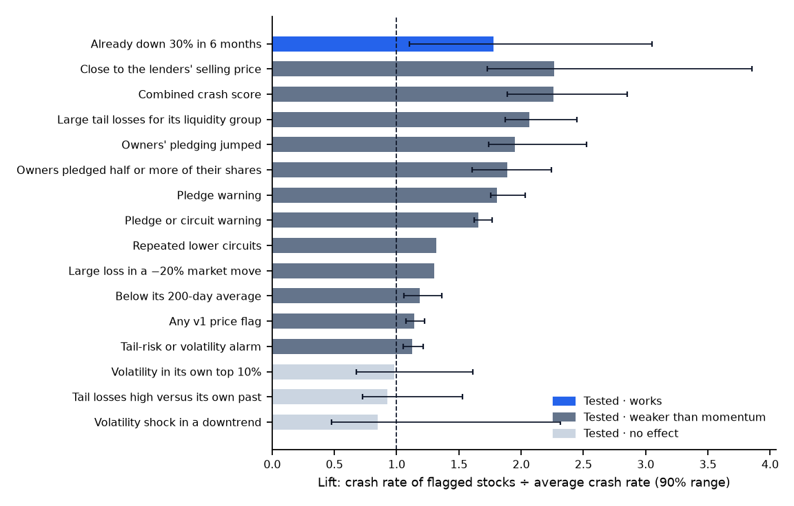

# What predicts 50% crashes in Indian stocks? Evidence from every NSE stock, 2016–2024

*A research note from the Risk Analysis Tool project. Every number below is generated from the committed results
files (`scripts/build_research_note.py`). Methods: [methodology](methodology.md); pre-registrations:
[price rules](preregistration_warnings_v2.md), [pledges](preregistration_events.md),
[margin trigger](preregistration_margin_trigger.md).*

## Summary

Which public signals warn that an Indian stock will lose half its value within a year? I tested the warning rules of
an open-source risk tool on **every NSE stock from 2016 to 2024**: 2,315 stocks, 397 of which
later disappeared, at 108 month-ends (174,532 stock-dates). The rules were fixed and committed
before each test was run.

- **The simplest rule is the one to beat.** "Down 30% in six months" (momentum) flags stocks that crash
  **1.78 times** as often as average out of sample, 2020–24 (90% range 1.10–3.05).
- **More elaborate price rules do not beat it by a margin the test can confirm.** The best, a combined logistic
  score (R4), reached a lift of 2.26 (1.89–2.85). The 90% range of its difference from momentum,
  −0.58 to +1.05, includes zero.
- **Promoter pledges warn, and add what momentum misses.** Owners who pledged half or more of their shares flag
  stocks that crash 1.89 times as often as average (range 1.60–2.24), 2022–24. Among stocks not already down
  30%, the lift stays 1.86 (1.52–2.15).
- **Being close to the lenders' selling price adds little beyond the pledge level.** The crash-rate ratio is
  1.29, range 0.93–2.25; this was pre-registered and is not supported.
- **One assumption failed and was removed.** Pledge-heavy stocks show no excess sudden crashes beyond their own
  history, so the tool's jump overlay defaults to zero.

## 1. Question

Indian equity collapses — Yes Bank, DHFL, Zee, Jet Airways, Future Retail, Adani Enterprises in 2023 — combine market,
liquidity, credit and governance stress. A risk tool can show many warning lights. The question is which of them
carry information: does a flagged stock fall **50% or more within 12 months** more often than an unflagged one, and
does the signal add anything to the simplest rule a portfolio manager already uses, a large recent fall?

## 2. Data

- **Prices:** NSE's daily bhavcopies, which keep stocks that later delisted or were suspended, so the sample has no
  survivorship bias. Prices are back-adjusted for bonuses and splits with NSE's corporate-action list.
- **Universe:** every NSE equity at each month-end from January 2016 to December 2024: 2,315 stocks,
  174,532 stock-dates, 26,319 of which were followed by a 50% fall (a base rate of 15.1%).
- **Outcome:** the lowest close in the next 252 trading days is at least 50% below the as-of close. A stock that
  stopped trading counts as observed only to its last close.
- **Pledges:** NSE's quarterly shareholding-pattern filings (27,033 filings, 2,165 companies,
  September 2021 – December 2024). Each filing counts only from its broadcast date, and later revisions are ignored.
  Until mid-2025 the filings report pledges together with other encumbrances, so the measure is an upper bound on
  pledges.
- **Access:** the data were downloaded from NSE's public archives before NSE's terms of use, which forbid automated
  collection and redistribution without permission, were found. Collection then stopped. The raw files are not
  redistributed; only derived statistics are published ([data sources](data_sources.md)).

## 3. Method

- **Lift** = crash rate among flagged stock-dates ÷ crash rate among all stock-dates. A lift of 2 means flagged stocks
  crashed twice as often as average.
- **Pre-registration.** Before each test the rules, thresholds, windows, metrics and decision rule were written down
  and committed to the public repository, so the git history proves the order. Results were computed once.
- **Design, embargo, test.** The new price rules were designed on 2016–18, 2019 was left out (its 12-month outcomes
  overlap the test), and they were tested once on 2020–24. The pledge rules use the tool's existing thresholds,
  tested on October 2022 – December 2024, the first window in which a 4-quarter change exists.
- **Uncertainty.** 90% ranges come from a circular block bootstrap of whole month-ends in blocks of 12, 2,000 resamples.
  Resampling dates rather than stocks keeps the cross-sectional correlation of crashes, and the blocks keep the
  overlap of 12-month outcomes. Differences from momentum use the same resamples.
- **Incremental lift.** The same lift computed only among stocks **not** already down 30% in six months, the test of
  whether a signal sees something momentum does not.
- **Evidence badges.** Fixed in advance: *works* if the range of lift − lift(momentum) is above 0; *weaker than
  momentum* if the lift range is above 1 but the difference range is not; *no effect* if the lift range includes 1.

## 4. Results

### 4.1 Every signal

| Signal | Lift (90% range) | Among stocks not down 30% | Test window | Evidence |
| --- | --- | --- | --- | --- |
| Already down 30% in 6 months (momentum baseline) | 1.78× (1.10–3.05) | — | 2020–24 | Tested · works |
| Close to the lenders' selling price (M1, encumbered ≥ 20% and within 10% of the pledge margin-call trigger) | 2.27× (1.73–3.85) | 1.92× (1.55–2.63) | Oct 2022 – Dec 2024 | Tested · weaker than momentum |
| Combined crash score (R4, logistic model on price features) | 2.26× (1.89–2.85) | 2.06× | 2020–24 | Tested · weaker than momentum |
| Large tail losses for its liquidity group (R2, peer-relative Expected Shortfall) | 2.07× (1.87–2.45) | 1.99× | 2020–24 | Tested · weaker than momentum |
| Owners' pledging jumped (E2, encumbrance up ≥ 10 pp in 4 quarters) | 1.95× (1.74–2.52) | 1.72× (1.51–2.06) | Oct 2022 – Dec 2024 | Tested · weaker than momentum |
| Owners pledged half or more of their shares (E1, promoter encumbrance ≥ 50%) | 1.89× (1.60–2.24) | 1.86× (1.52–2.15) | Oct 2022 – Dec 2024 | Tested · weaker than momentum |
| Pledge warning (E3p, event tier from pledges alone) | 1.81× (1.75–2.03) | 1.80× (1.71–1.96) | Oct 2022 – Dec 2024 | Tested · weaker than momentum |
| Pledge or circuit warning (E3, event tier Elevated/High) | 1.66× (1.62–1.77) | 1.66× (1.62–1.77) | Oct 2022 – Dec 2024 | Tested · weaker than momentum |
| Repeated lower circuits (v1 liquidity flag, ≥ 3 lower-circuit days) | 1.32× (no range) | — | 2016–24 | Tested · weaker than momentum |
| Large loss in a −20% market move (v1 integrated-stress flag) | 1.30× (no range) | — | 2016–24 | Tested · weaker than momentum |
| Below its 200-day average (baseline c) | 1.18× (1.06–1.36) | 1.11× | 2020–24 | Tested · weaker than momentum |
| Any v1 price flag (market, circuit or stress) | 1.14× (1.07–1.22) | 1.15× | 2020–24 | Tested · weaker than momentum |
| Tail-risk or volatility alarm (v1 market flag: ES95 ≥ 5% or EWMA ≥ 1.5× one-year volatility) | 1.12× (1.05–1.22) | 1.13× | 2020–24 | Tested · weaker than momentum |
| Volatility in its own top 10% (baseline b) | 0.98× (0.68–1.61) | 1.06× | 2020–24 | Tested · no effect |
| Tail losses high versus its own past (R1, own-history Expected Shortfall) | 0.93× (0.73–1.53) | 0.94× | 2020–24 | Tested · no effect |
| Volatility shock in a downtrend (R3, EWMA ≥ 1.5× one-year volatility and below the 200-day average) | 0.85× (0.48–2.31) | 0.81× | 2020–24 | Tested · no effect |
| On NSE's watch-list (ASM / GSM surveillance) | — | — | — | Not back-tested |
| In the F&O ban period (market-wide position limit) | — | — | — | Not back-tested |
| Credit rating cut or on negative watch (rating actions) | — | — | — | Not back-tested |
| Auditor resigned or qualified the accounts (auditor events) | — | — | — | Not back-tested |
| Several holdings from one business group (group links) | — | — | — | Not back-tested |
| Close to default on market values (Merton distance to default; RBI PCA for banks) | — | — | — | Not back-tested |

Lifts from different windows are best compared within a window: price rules 2020–24, pledge rules October 2022 –
December 2024, and the v1 liquidity and stress flags 2016–24 without a range.

### 4.2 Momentum is the benchmark to beat

On the full 2016–24 sample "down 30% in six months" has a lift of 2.24. In the out-of-sample test
window it is 1.78 (1.10–3.05). Its weakness is 2020, when the COVID crash flagged everything: its lift that
year was 0.76.

### 4.3 The tool's original price flags barely beat chance

The tool's v1 market flag (5% daily Expected Shortfall, or volatility 1.5 times its one-year level) fires on
**73% of all NSE stock-dates**, because its threshold was set with large caps in mind. On
2016–24 any v1 price flag has a lift of 1.13; out of sample, 1.14 (1.07–1.22). The threshold
was not re-tuned after this was seen. Instead, four new rules were pre-registered and tested.

### 4.4 Better price rules, but not confirmably better than momentum

- **R4, a combined logistic score** of tail risk, volatility, trend and liquidity, flags 4.1% of stock-dates
  with a lift of 2.26 (1.89–2.85). It beats both v1 flags and momentum's point estimate, but the 90% range of
  the difference from momentum is −0.58 to +1.05. By the pre-registered rule the challenger does not replace v1; the
  app shows both and says why.
- **R2, peer-relative tail risk** (top decile of Expected Shortfall within the stock's liquidity tercile), has a lift of
  2.07 (1.87–2.45). It stayed between 1.91 and 3.18 in every test year, including 2020.
  This is reported as exploratory.
- **R1, tail risk against the stock's own history**, does not warn: lift 0.93 (0.73–1.53).

### 4.5 Promoter pledges

| Rule | Lift (90% range) | Among stocks not down 30% |
| --- | --- | --- |
| E1: pledged or encumbered ≥ 50% of promoter holding | 1.89 (1.60–2.24) | 1.86 (1.52–2.15) |
| E2: encumbrance up ≥ 10 points in 4 quarters | 1.95 (1.74–2.52) | 1.72 |
| Momentum, same window | 2.40 | — |

Pledges warn, and the warning survives among stocks that have not yet fallen, which is where a risk manager needs
it. They do not beat momentum outright in this window.

### 4.6 Distance to the margin-call trigger (pre-registered October 2026)

A pledge becomes dangerous when the price falls far enough for lenders to sell. Using the tool's margin-call model —
the loan sized at the filing date with 2× cover, lenders selling at 1.5× — I asked whether stocks **within 10% of the
trigger** crash more often than other pledged stocks (5,069 stock-dates with encumbrance ≥ 20%,
27 month-ends).

| Fall to the trigger | Stock-dates | Crashes | Crash rate |
| --- | --- | --- | --- |
| < 10% (incl. past the trigger) | 645 | 91 | 14.1% |
| 10–25% | 1,865 | 222 | 11.9% |
| > 25% | 2,559 | 263 | 10.3% |

The crash rate rises as the trigger gets closer (14.1% against 11.0%), but the rate ratio of
1.29 has a 90% range of 0.93–2.25, which includes 1. **The pre-registered hypothesis is not supported.**
As a stand-alone signal the rule (M1) warns, with a lift of 2.27 (1.73–3.85), and among stocks not down 30% of
1.92 (1.55–2.63). That is mostly the pledge level and the price fall it requires.

### 4.7 Sudden crashes: an assumption that failed

The tool once assumed a High-tier stock had a 0.5% daily chance of a sudden 20% crash, about 72% a year. On NSE-wide
data, stocks with half or more of promoter shares encumbered show an excess daily rate of −0.010% over
their own trailing rate (90% range −0.026% to +0.002%). The base model already carries their history of falls, so the
overlay's default is now zero, with a grid showing what any assumed jump would add.

### 4.8 Case studies

Before six collapses (Yes Bank, DHFL, Zee, Jet Airways, Future Retail and Adani Enterprises in 2023), using only data
public at each date, the tool warned on 19 of 24 case dates, with false alarms on
9.2% of 240 control dates. "Price below its 200-day average" warned on 18, with
25% false alarms, and momentum on 9. On these dates the tool's edge is precision, not
catching more.

## 5. What failed

- The v1 tail-risk threshold, which fires on most small stocks.
- R1 (own-history tail risk) and R3 (a volatility shock in a downtrend), with no effect.
- The challenger R4, which did not beat momentum by a confirmable margin.
- The margin-trigger hypothesis.
- The jump-overlay assumption.

Each is reported in the tool and the repository rather than re-tuned.

## 6. Limitations

- **One market, two regimes.** 2016–24 includes one crash (2020) and a long bull market. The pledge and margin-trigger
  tests cover 27 month-ends, with overlapping 12-month outcomes, so their power is limited.
- **No 2025 holdout and no forward ledger.** Both need new NSE data, which this project stopped collecting after
  reading NSE's terms. A request for permission has been drafted.
- **Pledges are an upper bound** before mid-2025 (encumbrance includes non-disposal undertakings), and pledge history
  starts in 2021, so DHFL, Zee and Jet Airways cannot be tested on this pillar.
- **The outcome is a large fall, not default or fraud.** Some falls recover; some frauds never show in prices first.
- **Untested signals** (surveillance lists, F&O bans, rating actions, auditor events, group links, Merton distance to
  default) have no history in the data and carry a "not back-tested" badge.

## 7. How the tool uses this

Every signal in the app and on the website shows its badge and its tested lift. The official market flag stays v1
because the challenger did not win its pre-registered test. The pledge page leads with the pledge level, the trigger
price and their evidence, and the jump overlay is off by default. Website:
<https://singhwilliam15.github.io/Risk-Analysis-Tool/evidence/>.

## Appendix: lift by test year

| Rule | 2020 | 2021 | 2022 | 2023 | 2024 |
| --- | --- | --- | --- | --- | --- |
| Momentum (down 30% in 6 months) | 0.76 | 2.61 | 2.82 | 4.11 | 2.49 |
| R4 combined score | 1.93 | 1.27 | 2.72 | 2.49 | 2.13 |
| R2 peer-relative tail risk | 1.99 | 2.03 | 2.15 | 3.18 | 1.91 |
| v1 any price flag | 0.95 | 1.08 | 1.20 | 1.29 | 1.28 |
| Below 200-day average | 1.11 | 1.61 | 1.04 | 1.43 | 1.19 |
| Base crash rate | 6.4% | 4.8% | 7.6% | 1.7% | 11.0% |

Lift of each price rule in each year of the 2020–24 test, with the base rate of 50% falls among all NSE stock-dates
that year. Momentum's 2020 weakness and R2's stability are visible here.

## References

- Christoffersen, P. (1998). Evaluating interval forecasts. *International Economic Review*, 39(4), 841–862.
- Harvey, C. R., Liu, Y., & Zhu, H. (2016). … and the cross-section of expected returns. *Review of Financial
  Studies*, 29(1), 5–68.
- Jegadeesh, N., & Titman, S. (1993). Returns to buying winners and selling losers. *Journal of Finance*, 48(1), 65–91.
- Künsch, H. R. (1989). The jackknife and the bootstrap for general stationary observations. *Annals of Statistics*,
  17(3), 1217–1241.
- Merton, R. C. (1974). On the pricing of corporate debt. *Journal of Finance*, 29(2), 449–470.
- Nosek, B. A., Ebersole, C. R., DeHaven, A. C., & Mellor, D. T. (2018). The preregistration revolution. *PNAS*,
  115(11), 2600–2606.
- Politis, D. N., & Romano, J. P. (1992). A circular block-resampling procedure for stationary data. In *Exploring the
  Limits of Bootstrap*, 263–270. Wiley.
